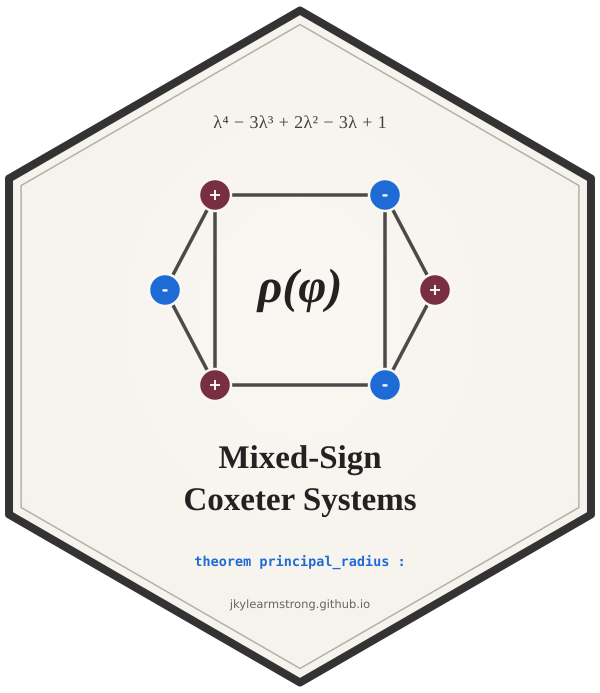

::: {.columns}
::: {.column width="72%"}
This portal accompanies **Johnathon Kyle Armstrong**, *Principal Elements of Mixed-Sign Coxeter Systems* (Ph.D. Dissertation, Florida State University, 2012), connecting the original mathematical theory with a **sorry-free Lean 4 formalization**, an **exact Python library**, and an **interactive Shiny Explorer**.

[FSU Dissertation PDF](https://repository.lib.fsu.edu/islandora/object/fsu:182755/datastream/PDF/view){.btn .btn-primary .btn-sm}
[GitHub Repository](https://github.com/jkylearmstrong/mixed.sign.coxeter.systems){.btn .btn-outline-secondary .btn-sm}
[Lean 4 Source](https://github.com/jkylearmstrong/mixed.sign.coxeter.systems/tree/main/lean/MixedSignCoxeter){.btn .btn-outline-secondary .btn-sm}
[Launch Explorer](explorer.qmd){.btn .btn-outline-primary .btn-sm}
:::
::: {.column width="28%"}
{width="210" fig-align="center" fig-alt="Mixed-Sign Coxeter Systems hex sticker"}
:::
:::

## Explore the Portal

::: {.grid}

::: {.g-col-12 .g-col-md-6}
::: {.card .h-100}
::: {.card-body}
### 📖 Dissertation
Full theorem-by-theorem audit mapping Chapters 1–3 and Appendices A–D to Lean 4 proofs and Python verifications.

[Open Dissertation Audit →](dissertation.qmd)
:::
:::
:::

::: {.g-col-12 .g-col-md-6}
::: {.card .h-100}
::: {.card-body}
### ✅ Lean Verification
16 `sorry`-free Lean 4 (`v4.35.0` + Mathlib) modules with formalization progress metrics and end-to-end traceability.

[Open Lean Dashboard →](lean-verification.qmd)
:::
:::
:::

::: {.g-col-12 .g-col-md-6}
::: {.card .h-100}
::: {.card-body}
### 🐍 Python Package
Exact symbolic `ReflectionSystem` and `MixedSignCoxeterGraph` computations, spectral plots, and Manim slides.

[Results](spectral-results.qmd) · [Executable Examples →](examples.qmd)
:::
:::
:::

::: {.g-col-12 .g-col-md-6}
::: {.card .h-100}
::: {.card-body}
### 🔬 Interactive Explorer
Build signed Coxeter graphs, compare linear vs. bipartite principal orderings, inspect spectra, and check theorems live.

[Launch Interactive Explorer →](explorer.qmd)
:::
:::
:::

:::

## What Is a Mixed-Sign Coxeter System?

A classical Coxeter system is realized geometrically by a symmetric bilinear form $B$ with **all positive** diagonal entries ($B_{ii} = 2$) and reflections
$$s_i(v) = v - \frac{2 B(e_i, v)}{B(e_i, e_i)} e_i.$$
A **mixed-sign Coxeter system** relaxes the positivity requirement on the diagonal: each node $i$ of the signed Coxeter graph $\Gamma$ carries a sign $+1$ ($B_{ii} = +2$) or $-1$ ($B_{ii} = -2$), while edges carry weights $m(i,j) \in \{2, 3, \dots, \infty\}$.

## Why Is It Interesting?

Allowing negative diagonal entries preserves the local reflection structure ($s_i^2 = I$, form preservation, Howlett's $U$-matrix factorization), yet **breaks** several cornerstones of classical Coxeter theory:

- **Deletion Property fails**: Odd negative cycles such as $\widetilde{A_{-2}}$ generate finite groups ($W(\widetilde{A_{-2}}) \cong S_4$ of order $24$) that violate the classical Deletion Property and cannot be $\mathcal{O}$-conjugate to any classical Coxeter system (**Theorem 1.2**, **Corollary 1.3**).
- **Signature obstructions**: Odd negative cycles $\widetilde{A_{-n}}$ ($n$ even) are strictly negative definite ($\det(-B) = 4$), hence never $\mathcal{O}$-conjugate to affine $\widetilde{A_n}$ (**Theorem 1.6**); in fact $W(\widetilde{A_{-n}}) \cong W(D_{n+1})$ for all even $n$.
- **Spectral-radius minimality fails**: A hyperbolic system can have spectral radius $\lambda(w) = 1$ (**Example 3.29**), and on a bipartite mixed-sign graph the bipartite principal element need not minimize the spectral radius (**Theorem 1.7**, **Example 3.33**).

## Research Portal Architecture

```{mermaid}
flowchart LR
  D["Dissertation (FSU, 2012)<br/>Ch. 1–3 &amp; Appendices A, B, D"] --> L["Lean 4 + Mathlib (v4.35.0)<br/>16 sorry-free modules"]
  D --> P["Python Package<br/>mixed_sign_coxeter"]
  L --> G["GitHub Source<br/>lean/MixedSignCoxeter/*.lean"]
  P --> T["Pytest Suite &amp; Searches<br/>isomorphisms, finite &amp; principal search"]
  P --> M["Manim Slide Deck<br/>slides/dissertation_deck.py"]
```

| Layer | Role | Where to Look |
| :--- | :--- | :--- |
| **Dissertation & Audit** | Full theorem-by-theorem verification matrix | [Dissertation & Audit](dissertation.qmd) |
| **Lean 4 Proofs** | 16 `sorry`-free Lean 4 modules covering Ch. 1–3 | [Lean Proofs](lean-verification.qmd) |
| **Spectral & Combinatorial Results** | Live Python plots, signature & search summaries | [Results](spectral-results.qmd) |
| **Executable Examples** | Interactive Python snippets + Manim slide deck | [Examples](examples.qmd) |
